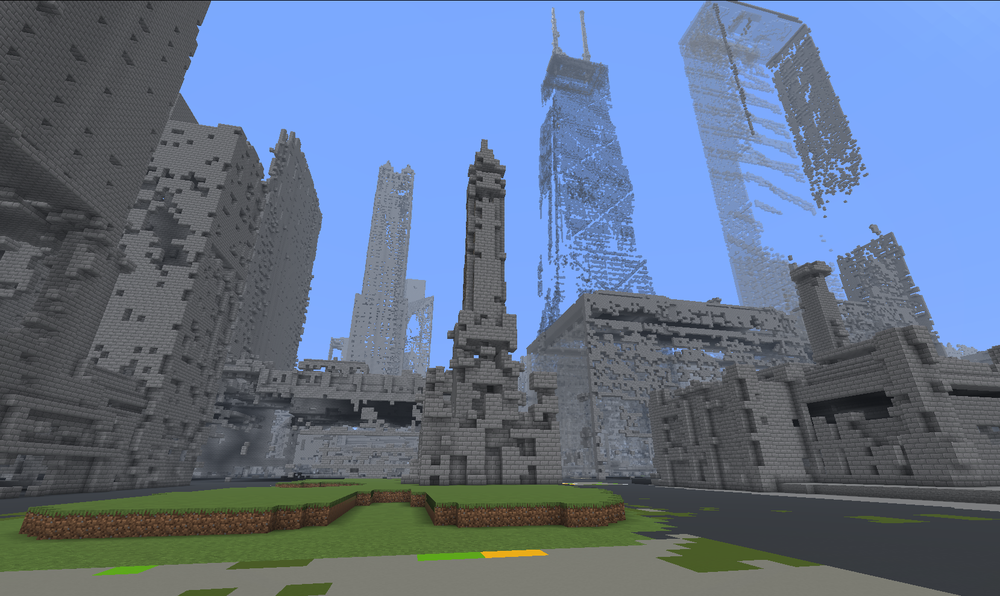

# Earthcraft

The whole Earth in Minecraft Java 1.21.10, at one block per metre. It starts
with the Chicago area.

- **Site:** [ericspencer.us/earthcraft](https://ericspencer.us/earthcraft/) — a map of what is built, and a 3D block viewer.
- **Data:** [huggingface.co/datasets/EricSpencer00/earthcraft](https://huggingface.co/datasets/EricSpencer00/earthcraft) — the world and every generated tile.



## How it works

1. The world is cut into 512 m × 512 m tiles.
2. `scripts/regional_generate.py` builds one tile at a time from open data
   (OpenStreetMap, USGS elevation and LiDAR, building footprints).
   `scripts/regional_supervisor.py` keeps the workers running.
3. Each finished tile is uploaded to the Hugging Face dataset by
   `scripts/hf_store.py`, then deleted locally. Local disk use stays capped.
4. `scripts/hf_install.py` downloads new tiles into the one Minecraft save and
   uploads the changed region files back to the dataset's `world/` folder.
5. Detail passes (`scripts/detail_*.py`) add trees, streets, cleaner buildings
   and water on top.

The pipeline runs unattended on one server. See [docs/PIPELINE.md](docs/PIPELINE.md).

## Play the world

1. Install Minecraft Java Edition 1.21.10.
2. Download the `world/` folder from the dataset (all of it, or only the
   regions you want). See [docs/DATASET.md](docs/DATASET.md) for the layout.
3. Put the region files in `saves/Earthcraft/region/` (flat, without the
   `<bx>/` subfolders) with the `level.dat` from `world/meta/`, and open the world.

## Run the pipeline

```sh
uv venv --python 3.11 .venv
uv pip install --python .venv/bin/python -r requirements-test.txt
PYTHONPATH=scripts .venv/bin/python -m unittest discover -s tests   # offline tests
```

Then follow [docs/PIPELINE.md](docs/PIPELINE.md). You need a Hugging Face
write token to upload.

## Where things live

| Path | What it is |
| --- | --- |
| `scripts/` | The pipeline: generator, supervisor, store, installer, detail passes, QA sampler. |
| `dashboard/` | The website (static files, no build step). Published by GitHub Pages. |
| `tests/` | Offline Python tests and browser tests for the site. |
| `configs/` | City list for the site, and a launchd template for the supervisor. |
| `progress/earth.json` | Coverage snapshot the site's map reads. Rebuilt on deploy. |
| `runtime/traversal/saves/Earthcraft` | The one Minecraft save (not in git). |
| `runs/` | Local control state and capped scratch (not in git). |

## Docs

- [docs/PIPELINE.md](docs/PIPELINE.md) — generate, upload, install, detail; disk rules.
- [docs/DATASET.md](docs/DATASET.md) — what is in the Hugging Face dataset.
- [docs/SITE.md](docs/SITE.md) — the map, the 3D viewer, and the view cache.
- [docs/STREET_DETAIL.md](docs/STREET_DETAIL.md) — the detail passes.
- [docs/HOSTING_AND_TERMS.md](docs/HOSTING_AND_TERMS.md) — hosting limits and data licences.
- [AGENTS.md](AGENTS.md) — rules for anyone (human or agent) working here.

## License

Code: [Apache 2.0](LICENSE). Map data © OpenStreetMap contributors, under the
ODbL. Other sources keep their own terms; see [NOTICE](NOTICE).

NOT AN OFFICIAL MINECRAFT PRODUCT. NOT APPROVED BY OR ASSOCIATED WITH MOJANG OR MICROSOFT.
