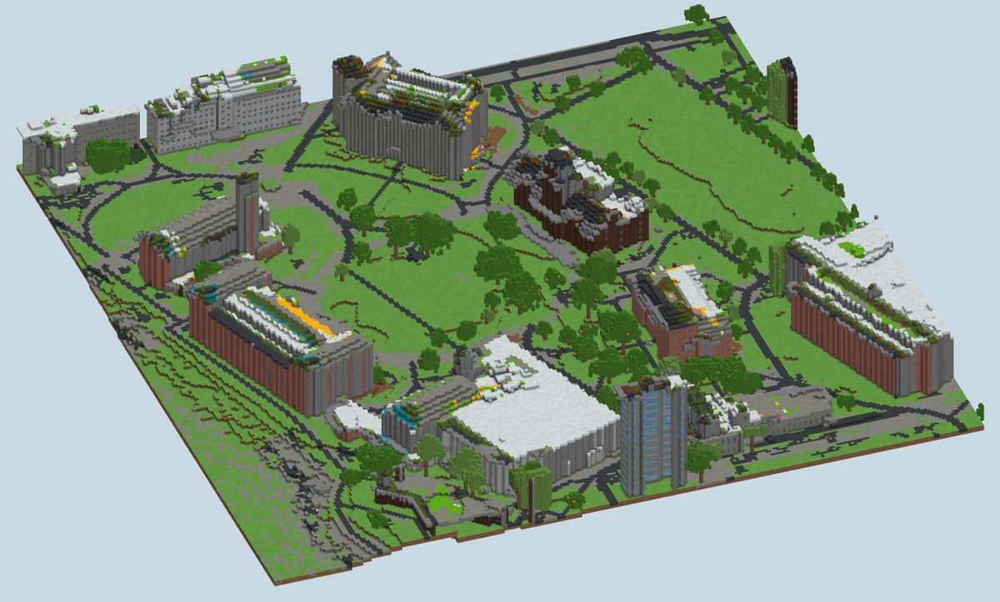
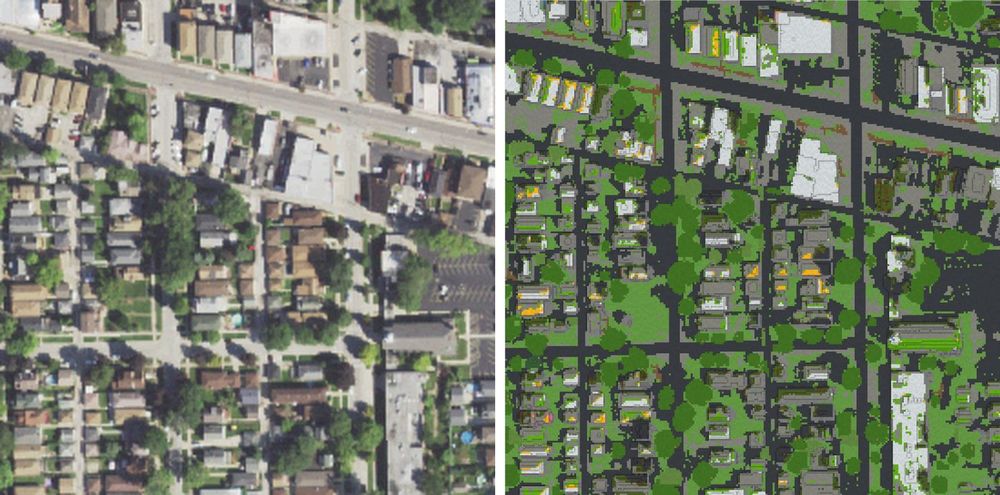
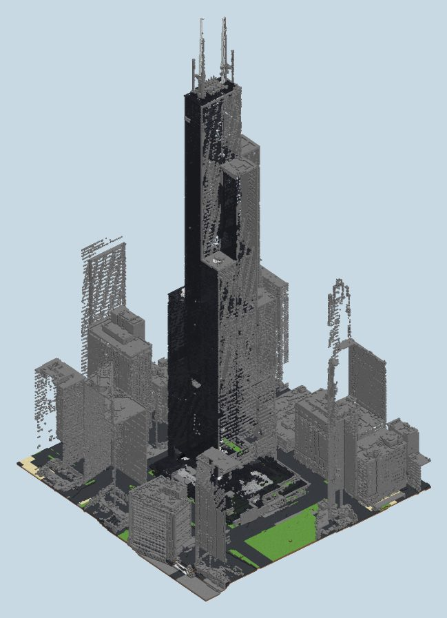
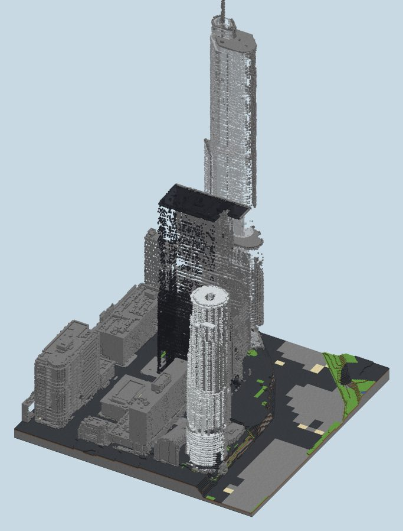
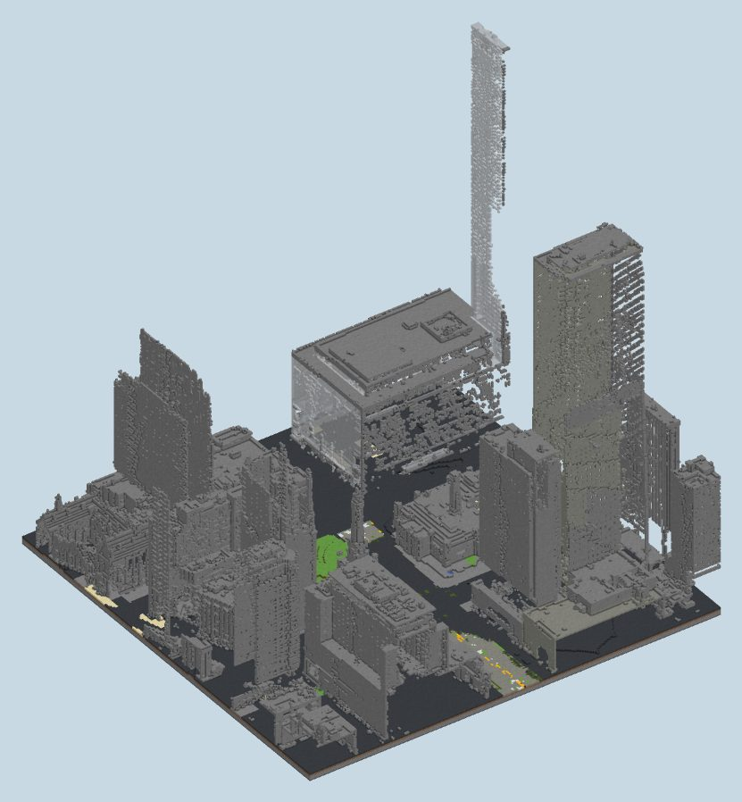
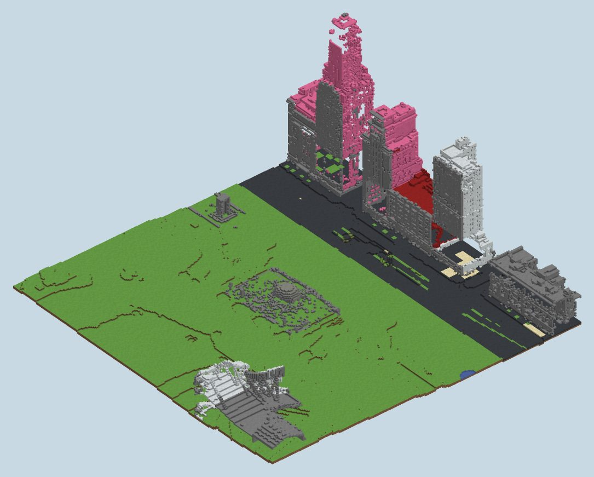
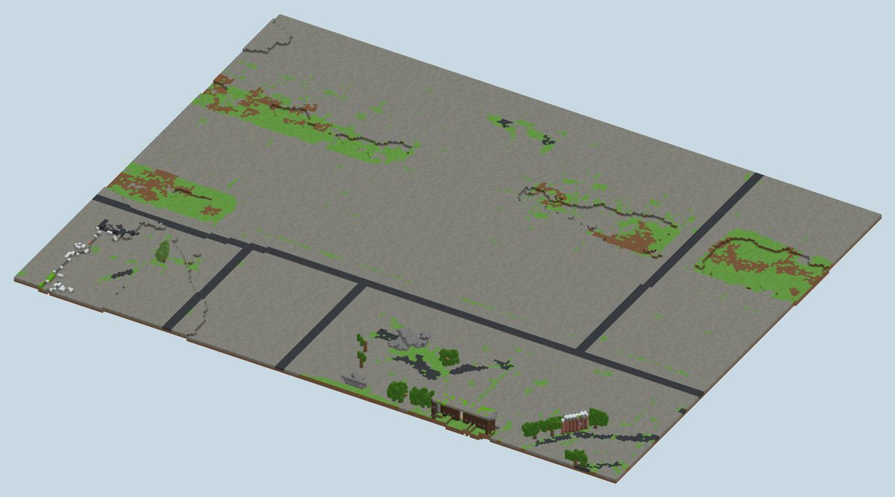
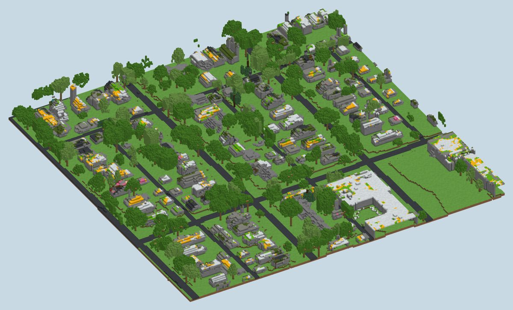
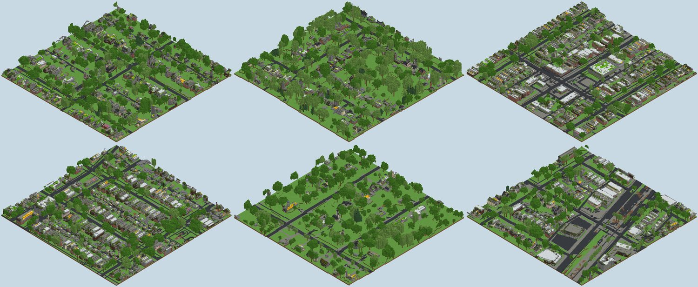
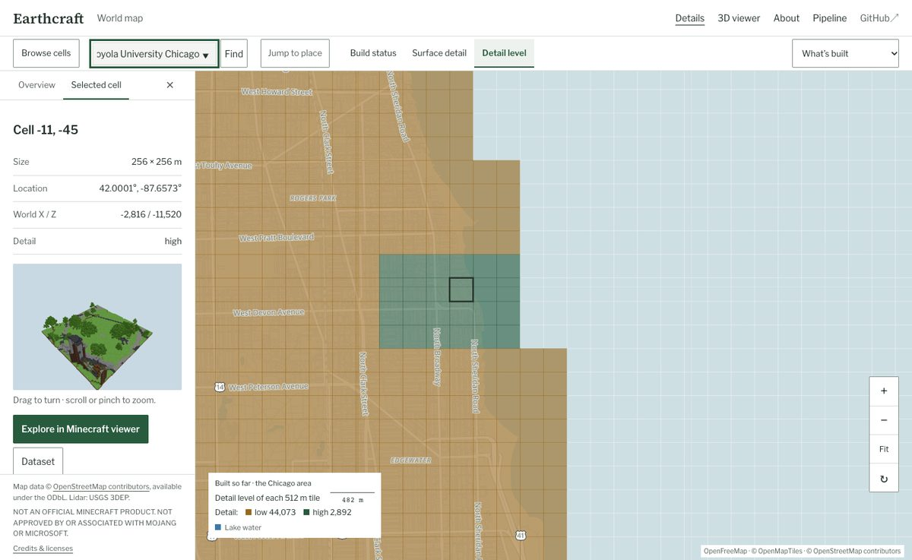

# Earthcraft

The whole Earth in Minecraft Java 1.21.10, at one block per metre. It starts
with the Chicago area, built entirely from free, open data.

- **Site:** [ericspencer.us/earthcraft](https://ericspencer.us/earthcraft/) — a map of what is built, and a 3D block viewer.
- **Data:** [huggingface.co/datasets/EricSpencer00/earthcraft](https://huggingface.co/datasets/EricSpencer00/earthcraft) — the world and every generated tile.



<sub>Loyola University Chicago, Lake Shore campus: USGS lidar for the ground, buildings and trees; aerial photos for roof colours; OpenStreetMap for paths and lawns.</sub>

## What the world looks like

### From the air to blocks

Every tile is checked against the aerial photo it was built from. Left: the
USDA NAIP photo of a Chicago neighbourhood. Right: the same 272 m square in
Earthcraft, seen from straight above.



### Downtown

<table>
<tr>
<td width="33%"></td>
<td width="33%"></td>
<td width="33%"></td>
</tr>
<tr>
<td align="center"><sub>Willis Tower</sub></td>
<td align="center"><sub>Trump Tower and Marina City</sub></td>
<td align="center"><sub>Around the Water Tower</sub></td>
</tr>
</table>

<table>
<tr>
<td width="50%"></td>
<td width="50%"></td>
</tr>
<tr>
<td align="center"><sub>Millennium Park and Michigan Avenue</sub></td>
<td align="center"><sub>O'Hare: aprons, taxiways and the terminal</sub></td>
</tr>
</table>

### Neighbourhoods

Houses with windows and front doors, lidar trees, driveways, sidewalks,
alleys and parking lots.



Six of the most detailed tiles published on 2026-10-25, each 512 m across:



### On the site

Search any place, see which tiles are built and how detailed they are, and
turn the blocks in your browser.



<sub>Renders come from the published tiles in the site's block viewer. Data: © OpenStreetMap contributors (ODbL), USGS 3DEP lidar, USDA NAIP imagery (public domain), ESA WorldCover 2021 (CC BY 4.0), Cook County Assessor.</sub>

## What is in a tile

| Layer | Source |
| --- | --- |
| Ground height | USGS 3DEP lidar and elevation |
| Building shapes and heights | USGS lidar points, Overture and OSM footprints |
| Roof colours | USDA NAIP aerial photos |
| Walls, floors, windows, a street door | OSM tags and the Cook County Assessor |
| Trees | Each tree found in the lidar, at its real height and crown size |
| Sidewalks, driveways, parking, fields, prairie, wetland | NAIP, ESA WorldCover and OSM areas |
| Roads, rail and water | OpenStreetMap; Lake Michigan from NOAA bathymetry |

No API keys and no Google data. Every layer keeps its source and licence in
the tile's `earthcraft.json`.

## Progress

On 2026-10-25 the plan for the Chicago area is 95,399 tiles of 512 m × 512 m.
About 46,000 are published and almost 2,900 have full detail (scans, trees,
facades, ground cover). One spot server builds about 85 detailed tiles an hour
for under $35 a month. The [pipeline page](https://ericspencer.us/earthcraft/pipeline.html)
shows the live numbers.

## Contribute your compute

Your computer can build tiles and offer them to the dataset. You need Python
3.11+, git, about 30 GB of free disk, Minecraft 1.21.10 (started once, for its
block colours) and a free Hugging Face account.

```sh
git clone https://github.com/EricSpencer00/earthcraft && cd earthcraft
python3 -m venv .venv
.venv/bin/pip install -r requirements-contribute.txt
.venv/bin/hf auth login                                    # a token with write access
.venv/bin/python scripts/contribute.py --tiles 20 --dry-run   # see which tiles you would build
.venv/bin/python scripts/contribute.py --tiles 20             # build them and open one pull request
```

1. The tool picks tiles nobody has built or claimed, starting at the far edge
   of the plan, away from the main server.
2. It builds them with the same generator the server runs, a few minutes each.
3. It opens one pull request on the dataset with only those tiles.
4. A validator checks every file (valid regions, no player data, hashes that
   match, tiles in the plan), rebuilds one tile now and then to compare, and
   comments **PASS** or **FAIL** within about half an hour. The owner merges passing requests, and the server stops
   building those tiles.

Several computers can split the work with `--shard 0/3`, `--shard 1/3` and
`--shard 2/3`. The full guide is in [CONTRIBUTING.md](CONTRIBUTING.md#contribute-compute).

## How it works

1. The world is cut into 512 m × 512 m tiles.
2. `scripts/regional_generate.py` builds one tile at a time from open data.
   `scripts/regional_supervisor.py` keeps the workers running.
3. Each finished tile is uploaded to the Hugging Face dataset by
   `scripts/hf_store.py`, then deleted locally. Local disk use stays capped.
4. `scripts/hf_install.py` downloads tiles into the one Minecraft save.
5. Trees, facades and ground cover are added in one pass over each tile.

The pipeline runs unattended on one server. See [docs/PIPELINE.md](docs/PIPELINE.md)
and [docs/PERFORMANCE.md](docs/PERFORMANCE.md).

## Play the world

1. Install Minecraft Java Edition 1.21.10.
2. Download the regions you want. The whole Chicago world is in `world/`, and
   each newer tile is under `tiles/v2/<tile>/`. See [docs/DATASET.md](docs/DATASET.md).
3. Put the region files in `saves/Earthcraft/region/` (flat, without the
   `<bx>/` subfolders) with the `level.dat` from `world/meta/`, and open the world.

A few regions load fast. The full world is tens of gigabytes, so start with
the places you want to see.

## Run the pipeline

```sh
uv venv --python 3.11 .venv
uv pip install --python .venv/bin/python -r requirements-test.txt
PYTHONPATH=scripts .venv/bin/python -m unittest discover -s tests   # offline tests
```

Then follow [docs/PIPELINE.md](docs/PIPELINE.md). You need a Hugging Face
write token to upload.

## Where things live

| Path | What it is |
| --- | --- |
| `scripts/` | The pipeline: generator, supervisor, store, installer, detail passes, QA sampler. |
| `dashboard/` | The website (static files, no build step). Published by GitHub Pages. |
| `tests/` | Offline Python tests and browser tests for the site. |
| `configs/` | City list for the site, and service templates for the server. |
| `progress/earth.json` | Coverage snapshot the site's map reads. Rebuilt on deploy. |
| `docs/readme/` | The pictures on this page. |
| `runtime/traversal/saves/Earthcraft` | The one Minecraft save (not in git). |
| `runs/` | Local control state and capped scratch (not in git). |

## Docs

- [docs/PIPELINE.md](docs/PIPELINE.md) — generate, upload, install, detail; disk rules.
- [docs/PERFORMANCE.md](docs/PERFORMANCE.md) — where a tile's time goes.
- [docs/DATASET.md](docs/DATASET.md) — what is in the Hugging Face dataset.
- [docs/SITE.md](docs/SITE.md) — the map, the 3D viewer, and the view cache.
- [docs/STREET_DETAIL.md](docs/STREET_DETAIL.md) — the detail passes.
- [docs/HOSTING_AND_TERMS.md](docs/HOSTING_AND_TERMS.md) — hosting limits and data licences.
- [CONTRIBUTING.md](CONTRIBUTING.md) — code changes and compute contributions.
- [AGENTS.md](AGENTS.md) — rules for anyone (human or agent) working here.

## License

Code: [Apache 2.0](LICENSE). Map data © OpenStreetMap contributors, under the
ODbL. Other sources keep their own terms; see [NOTICE](NOTICE).

NOT AN OFFICIAL MINECRAFT PRODUCT. NOT APPROVED BY OR ASSOCIATED WITH MOJANG OR MICROSOFT.
